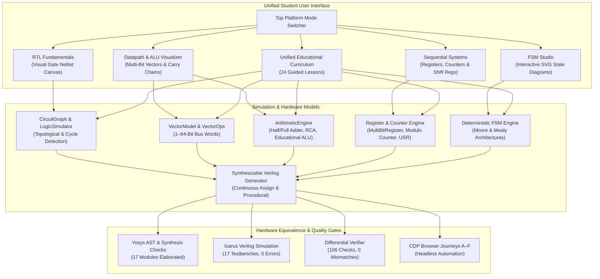

# PD Playground — Interactive RTL Design & Educational VLSI Suite

[](https://github.com/ppawar-7/rtl-playground/actions/workflows/ci.yml)
[](LICENSE)
[](https://ppawar-7.github.io/rtl-playground/)

**Comprehensive Digital Logic & RTL Educational Learning Platform**  
*Part of the PD Playground University Capstone Project: An Interactive Learning Tool for ASIC Physical Design*

- **Live Application**: [https://ppawar-7.github.io/rtl-playground/](https://ppawar-7.github.io/rtl-playground/)
- **Companion STA Playground**: [https://ppawar-7.github.io/sta-playground/](https://ppawar-7.github.io/sta-playground/)

---

## 1. Executive Overview

**PD Playground** is an interactive, browser-based digital design platform engineered to teach students and VLSI beginners how combinational and sequential hardware is modeled in Verilog HDL and how circuits physically operate in silicon.

The platform provides a continuous, tiered learning path from fundamental single-bit logic gates up to multi-bit vector datapaths, arithmetic logic units (ALUs), multi-bit registers, binary counters, universal shift registers, and deterministic Finite State Machines (Moore & Mealy architectures).

### Key Architectural Strengths
- **Zero Framework / Zero Build Step**: 100% vanilla ES modules and static web standards. No bundlers or Node.js runtime required to run the student UI.
- **Dual Verification Engines in WebAssembly**:
  - **YoWASP Yosys**: Real-time IEEE 1364 Verilog AST parsing, hierarchy elaboration, and formal design rule checks (`@yowasp/yosys`).
  - **Icarus Verilog WASM**: IEEE 1364 event-driven simulator compiling self-checking testbenches inside Node.js (`@veriflow/iverilog-wasm`).
- **Bit-for-Bit Differential Verification**: Automated cycle-accurate equivalence suite verifying 106 differential vectors between browser JavaScript engines and compiled Verilog with 0 mismatches.
- **Unified 24-Lesson Progressive Curriculum**: 12 single-bit fundamental exercises and 12 multi-bit advanced challenges with automatic behavioral solution checking.
- **Seamless Bi-Directional Platform Navigation**: Integrated platform switcher connecting RTL Fundamentals, Datapaths & ALU, Sequential Systems & Counters, and FSM Studio.
- **Subpath Hosting Ready**: Verified for clean deployment on GitHub Pages (`/rtl-playground/`) with zero root leakage.

---

## 2. Platform Capabilities & Architecture



---

## 3. Core Modules & Learning Tiers

### Tier 1: Single-Bit RTL Fundamentals (`index.html`)
- **Interactive Drag-and-Drop Netlist Canvas**: Visual placement, wire routing, real-time signal coloring (`1` green, `0` gray, `null` red dashed).
- **Component Palette**: Digital Inputs (interactive toggle), Outputs, Clock, 7 standard gates (`AND`, `OR`, `NOT`, `NAND`, `NOR`, `XOR`, `XNOR`), 2:1 Multiplexer (`MUX2`), and 4 first-class sequential registers:
  - Standard D Flip-Flop (`DFF`)
  - Register with Clock Enable (`DFFE`)
  - Register with Synchronous Reset (`DFFSR`)
  - Register with Enable & Synchronous Reset (`DFFESR`, Reset > Enable priority)
- **Interactive Verilog Explainer Bar**: 6 concept cards with synthesizable code patterns and ASIC cell mappings (`assign`, `always @(*)`, `if/else`, `case`, `always @(posedge clk)`, `= vs <=`).
- **Dual Coding Perspectives**: Toggle between **Continuous Dataflow (`assign`)** and **Procedural Behavioral (`always @(*)`, `case`)** views.
- **Waveform Viewer & Truth Table**: Canvas timing diagrams tracking `CLK`, `D`, `Q`, `EN`, `RST` across clock steps; exhaustive truth table generator with active-row tracking.
- **16 Educational Presets & 12 Guided Lessons**: With instant level-up prompts to the Advanced RTL Lab upon completion.

### Tier 2: Advanced RTL Lab (`advanced-lab/index.html`)
- **Multi-Bit Vectors & Slicing**: Arbitrary 1–64 bit signals, big-endian bit extraction (`vec[7:4]`), concatenation (`{A, B}`), and zero/sign-extension.
- **Arithmetic Datapaths & ALU**: 
  - Parameterized Ripple-Carry Adder with visual stage-by-stage carry propagation (`G`, `P`, `Cin`, `Cout`).
  - Educational 4-bit ALU executing ADD, SUB, AND, OR, XOR, NOT, SHL, SHR with condition status flags ($Z, C, V, N$).
- **Sequential Systems & Modulo Counters**:
  - Multi-bit registers with simultaneous nonblocking pipeline updates.
  - Modulo binary counters (up/down) with terminal count detection and rollover.
  - Universal Shift Register supporting parallel load, shift right, shift left, and hold modes.
- **Finite State Machine (FSM) Studio**:
  - Interactive SVG state diagrams with real-time active state glow.
  - Deterministic transition evaluator with Moore and Mealy output decoding.
  - 2-Process synthesizable Verilog export with clean state parameterization.
  - AST Boolean condition parser with zero `eval()`.
- **Multi-Bit Hexadecimal Bus Waveforms**: Hexagonal bus envelopes (`< 0xA >`) for vector data and timing validation.

---

## 4. Comprehensive 24-Lesson Curriculum

| # | Lesson Title | Tier | Core Concept & Objective |
|:---:|---|---|---|
| **1** | Understanding Logic Gates | Fundamentals | Construct 2-input AND gate and verify Boolean truth table |
| **2** | Building a Half Adder | Fundamentals | 1-bit adder producing SUM (XOR) and CARRY (AND) |
| **3** | 2:1 Multiplexer | Fundamentals | Conditional data steering using select line |
| **4** | D Flip-Flop Register | Fundamentals | Rising-edge state storage and clock sensitivity |
| **5** | MUX with Conditional Operator (`? :`) | Fundamentals | Synthesizable continuous assignment `assign y = sel ? b : a` |
| **6** | Register with Clock Enable (MUX) | Fundamentals | Clock gating mitigation via recirculation MUX |
| **7** | Synchronous Reset Architecture | Fundamentals | Deterministic posedge initialization without glitching |
| **8** | Clock Timing & Waveforms | Fundamentals | Hold, setup, and sequential propagation cycles |
| **9** | 1-Bit Full Adder with Ripple | Fundamentals | Full 8-state addition with input carry $C_{in}$ |
| **10** | Native Register with Clock Enable (`DFFE`) | Fundamentals | Hardware-synthesizable DFFE with nonblocking Verilog |
| **11** | Priority in DFF with Enable & Sync Reset | Fundamentals | Strict reset-over-enable evaluation order in RTL |
| **12** | Blocking vs Nonblocking Semantics | Fundamentals | Pipeline race conditions (`=` vs `<=`) and synthesis equivalence |
| **13** | Multi-Bit Vectors & Slicing | Advanced | Bus extraction `data[7:4]` and `data[3:0]` |
| **14** | Bus Concatenation & Extension | Advanced | Assemble 12-bit address word using `{page, offset}` |
| **15** | Carry Lookahead vs Ripple Carry | Advanced | Carry generation ($G$) and propagation ($P$) stages |
| **16** | ALU Status Flags ($Z, C, V, N$) | Advanced | Zero, Carry, Signed Overflow, and Negative flag evaluation |
| **17** | Multi-Bit Register Recirculation | Advanced | Multi-bit bus retention when clock enable is inactive |
| **18** | Register Priority in Hardware | Advanced | Active-high synchronous reset dominating enable in vector regs |
| **19** | Modulo Binary Counters | Advanced | Up/down counter with modulo rollover and terminal count |
| **20** | Universal Shift Register | Advanced | Bidirectional shift and parallel load modes (SISO/SIPO/PISO) |
| **21** | Sequence Detector FSM | Advanced | Deterministic state machine detecting `101` pattern |
| **22** | Moore vs Mealy Output Timing | Advanced | State-only Moore vs input-dependent zero-latency Mealy outputs |
| **23** | Combinational Latch Inference | Advanced | Complete branch coverage avoiding unwanted transparent hardware latches |
| **24** | Self-Checking Verilog Testbenches | Advanced | Automated verification testbench with clock generation and assertions |

---

## 5. Verification & Test Commands

Run all verification suites directly using Node.js:

```bash
# 1. Run Master Consolidated Integration Regression Suite
npm run test:all

# 2. Run RTL Fundamentals & Phase 6 Unit Tests (49 tests)
npm test

# 3. Run Advanced RTL Lab Test Suite & Property Tests (8 suites, 5,470+ assertions)
npm run test:advanced

# 4. Run Real Yosys HDL Synthesis on All 17 Verilog Modules
npm run test:yosys

# 5. Run Icarus Verilog Simulation on All 17 Testbenches
npm run test:iverilog

# 6. Run Cross-Engine Differential Verification (106 checks)
npm run test:differential

# 7. Run GitHub Pages Subpath Audit (/rtl-playground/)
npm run test:subpath

# 8. Run Cross-Platform Navigation & Deep-Link Audit
npm run test:e2e

# 9. Run Headless Browser UI Audits
npm run test:browser              # RTL Fundamentals Audit
npm run test:browser:advanced     # Advanced RTL Lab Audit
```

---

## 6. Verification Status Summary

- **Unit Tests**: 49 / 49 Passed (100%)
- **Advanced RTL Lab Assertions**: 5,474 / 5,474 Passed (100%)
- **Yosys Synthesis Check**: 17 / 17 Modules Synthesizable (0 latches, 0 errors)
- **Icarus Verilog Testbenches**: 17 / 17 Suites Passed (0 assertion errors)
- **Cross-Engine Differential Parity**: 106 / 106 Checks Passed (0 mismatches)
- **GitHub Pages Subpath Audit**: 42 / 42 Requests Valid (0 root violations under `/rtl-playground/`)
- **Cross-Platform Browser Audits**: 100% Passed across both portals (0 uncaught exceptions)
- **Long-Duration Stress Harness (2 Hours)**: Formally completed full run (`run_20261029_003549`): 129,494 batches, 453,229 circuits generated, 1,338,342 simulation cycles, 0 failures, bounded heap (8.89 MB $\to$ 12.83 MB)
- **Release Status**: **`v0.2.0-rc1` Verified & Approved**.

---

## 7. Deep Architecture & Technical Documentation

- [System Architecture Deep Dive](docs/SYSTEM_ARCHITECTURE_DEEP_DIVE.md)
- [Test Coverage & Hardware Traceability Matrix](docs/TEST_COVERAGE_TRACEABILITY.md)
- [RTL Learning Coverage Matrix (46 Topics Reconciled)](docs/RTL_LEARNING_COVERAGE_MATRIX.md)
- [Known Limitations & Modeling Approximations](docs/KNOWN_LIMITATIONS.md)
- [In-Repository AI Handoff & Transfer Guide](docs/HANDOFF_TO_INCOMING_AI.md)
- [Full RTL Release Checklist (14 Verified Quality Gates)](docs/FULL_RTL_RELEASE_CHECKLIST.md)
- [Full RTL Integration Report](docs/FULL_RTL_INTEGRATION_REPORT.md)
- [Full RTL Verification Report](docs/FULL_RTL_VERIFICATION_REPORT.md)
- [Phase 7 RTL-to-STA Bridge Architecture Design](docs/RTL_TO_STA_BRIDGE_DESIGN.md)

---

## 8. License

This project is licensed under the [MIT License](LICENSE).
Part of the PD Playground project by Pranil Pawar (`ppawar-7`).
