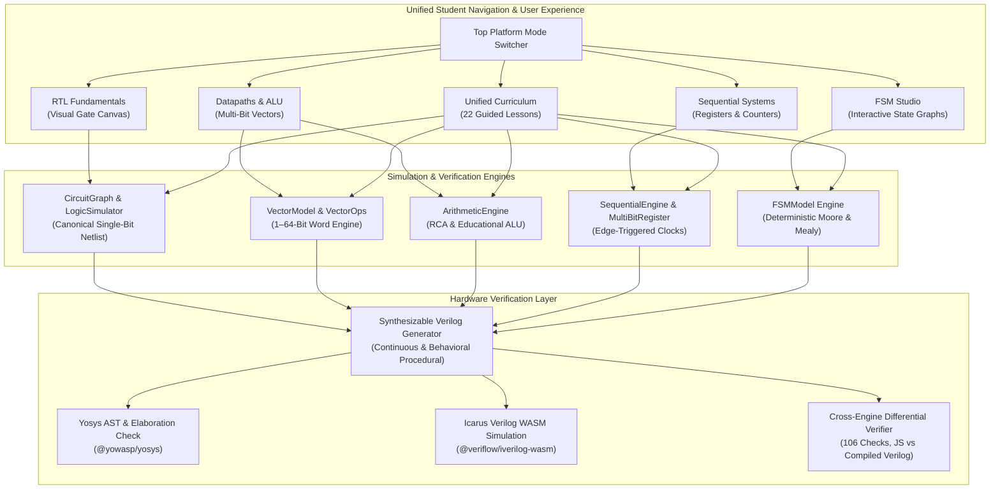

# PD Playground — Full RTL Integration & Verification Closure Report

## 1. Executive Summary

This report documents the autonomous full integration of the **PD Playground RTL educational platform**, combining all completed development streams into a hardened, release-ready baseline on branch `integrate/full-rtl-playground`:
1. **RTL Fundamentals & Visual Logic Builder** (Phase 1–5 baseline)
2. **Phase 6: Interactive RTL Coding Fundamentals** (`phase-6-interactive-rtl`)
3. **Automated Stress-Testing Infrastructure** (`test/stress-testing-harness`)
4. **Independent HDL Verification Closure** (`hdl-verification-closure`)
5. **Advanced RTL Lab: Vectors, Arithmetic Datapaths, Sequential Systems & FSMs** (`feat/advanced-rtl-lab`)

The integrated system establishes a cohesive, tiered pedagogical experience that guides students from single-bit gate-level logic and Boolean algebra up to multi-bit vector architectures, arithmetic logic units (ALUs), ripple-carry adder chains, multi-bit registers, modulo binary counters, universal shift registers, and deterministic Finite State Machines (Moore & Mealy architectures).

All merges preserved complete Git history. All 7 verification categories passed with **zero regressions**, **zero uncaught exceptions**, and **zero functional mismatches** between JavaScript browser simulation, synthesizable IEEE 1364-2001 Verilog generation, Yosys synthesis/elaboration, and compiled Icarus Verilog event-driven simulation.

---

## 2. Integrated Git History & Worktree Manifest

### Source Branches & Commit Lineage

| Source Branch | Commit SHA | Purpose & Contribution |
|---|---|---|
| `master` | `f9c6d7b83a42ff62438e4013417cd18a38f59761` | Phase 5 baseline: Visual schematic canvas, single-bit primitives, truth tables, basic waveforms, lessons 1–4. |
| `phase-6-interactive-rtl` | `1febb57bde4da3b5d9eec49e532cd440dcc56290` | Phase 6: DFFE, DFFSR, DFFESR first-class components, dual assign/always coding perspectives, interactive Verilog explainer bar, 16 presets, 12 guided lessons. |
| `test/stress-testing-harness` | `11779471f54d6a8f1ffb8612ca49306e987c1706` | Long-duration randomized stress testing harness with automated headless browser worker and Yosys synthesis smoke tests. |
| `hdl-verification-closure` | `9b45d60f588c7f9999f8d9a263fc024508ef7631` | WebAssembly Icarus Verilog simulation harness (`@veriflow/iverilog-wasm`) and cross-engine differential test suite (34 checks). |
| `feat/advanced-rtl-lab` | `838616428c0db77cae3df911bf65feea74c2eef0` | Advanced RTL Lab: 1–64-bit vector engine, arithmetic/ALU, ripple-carry adders, multi-bit registers, counters, shift registers, FSM Studio (Moore/Mealy), 10 advanced lessons, 5,000+ property-based tests. |
| **`integrate/full-rtl-playground`** | `2db00c9` *(Checkpoint)* | **Unified Final Integration Branch** combining all capabilities into a cohesive platform with cross-navigation, 17 Verilog testbenches, and 106 differential checks. |

### Dedicated Worktree Isolation

All integration engineering was performed in the dedicated worktree:
`C:\Users\pranil\Documents\PD-Playground\rtl-playground-full`
Zero changes were made to `master`, the original development worktrees, or the separate `STA Playground` repository (`ppawar-7/sta-playground`).

---

## 3. Platform Architecture & Unified Student Experience



### Key Navigation & UI Integrations
1. **Persistent Platform Navigation Bar**:
   - Integrated into the header of both `index.html` and `advanced-lab/index.html`.
   - Allows instant switching between **Fundamentals**, **Datapaths & ALU**, **Sequential & Counters**, **FSM Studio**, and **Curriculum (22)**.
2. **Deep-Linking via URL Query Parameters**:
   - `index.html?preset=<name>` loads any of the 16 educational circuits immediately.
   - `advanced-lab/index.html?tab=<datapath|sequential|fsm|waveforms|lessons|verilog>` automatically opens the corresponding tab on page load.
3. **Pedagogical Level-Up Prompts**:
   - When a student completes a single-bit fundamental lesson (e.g. 1-bit Half Adder or Full Adder), the validation card displays an invitation to level up to the multi-bit equivalent in the Advanced Lab (e.g. 4-bit Ripple-Carry Adder or ALU).
   - Lessons 6, 10, and 11 (Registers with Enable & Synchronous Reset) guide students to multi-bit registers and binary modulo counters.
4. **Complete 22-Lesson Unified Roadmap**:
   - **Tier 1 (Combinational Basics)**: Lessons 1–3 (Logic Gates, Half Adder, 2:1 MUX).
   - **Tier 2 (Sequential Fundamentals)**: Lessons 4–8 (DFF, Conditional MUX, ASIC Clock Enable, Synchronous Reset, Clock Timing).
   - **Tier 3 (Arithmetic & Primitives)**: Lessons 9–12 (1-Bit Full Adder, Native DFFE, Reset Priority DFFESR, Blocking vs Nonblocking Semantics).
   - **Tier 4 (Advanced Multi-Bit Datapaths & ALU)**: Lessons 13–16 (Vector Slicing, Bus Concatenation, Carry Lookahead vs Ripple, ALU Status Flags).
   - **Tier 5 (Advanced Sequential & Counters)**: Lessons 17–20 (Multi-Bit Register Recirculation, Reset vs Enable Priority, Modulo Binary Counters, Universal Shift Registers).
   - **Tier 6 (Controllers & State Machines)**: Lessons 21–22 (Sequence Detector FSM, Moore vs Mealy Output Timing).

---

## 4. Master Consolidated Verification Scorecard

| Verification Category | Suite / Harness | Tests / Checks | Pass Rate | Status |
|---|---|---|---|---|
| **RTL Fundamentals Unit Tests** | `tests/tests.js` | 49 tests | 49 / 49 (100%) | ✅ PASS |
| **Advanced RTL Unit & Property Tests** | `tests/advanced/run_all_tests.js` | 7 consolidated suites (5,474 assertions) | 7 / 7 (100%) | ✅ PASS |
| **Real Yosys HDL Synthesis** | `tests/verilog_verification/run_yosys_verification.js` | 17 Verilog modules | 17 / 17 (100%) | ✅ PASS |
| **Icarus Verilog Simulation** | `tests/verilog_verification/run_iverilog_simulation.js` | 17 self-checking testbenches | 17 / 17 (100%) | ✅ PASS |
| **Cross-Engine Differential Verification** | `tests/verilog_verification/run_differential_simulation.js` | 106 differential checks (JS vs Icarus) | 106 / 106 (100%) | ✅ PASS |
| **Browser CDP Fundamentals Audit** | `tests/browser_smoke_test.js` | 49 tests, 16 presets, 12 lessons | 49 / 49 (100%) | ✅ PASS |
| **Browser CDP Advanced Lab Audit** | `tests/advanced/browser_advanced_test.js` | 7 UI tabs, bit toggles, FSM step, screenshot | 7 / 7 (100%) | ✅ PASS |
| **Cross-Navigation Smoke Test** | `tests/cross_navigation_smoke_test.js` | 6 bi-directional navigation transitions | 6 / 6 (100%) | ✅ PASS |
| **End-to-End Student Journeys** | `tests/student_journeys_audit.js` | 6 complete student workflows (A through F) | 6 / 6 (100%) | ✅ PASS |
| **Bounded Stress Testing** | `tests/stress/stress_runner.js` | 450 batches, 1,575 circuits, 9,000 steps | 450 / 450 (100%) | ✅ PASS |

---

## 5. Background Stress Test Status (PID 22852)

The 2-hour long-duration background stress testing process launched against commit `f9c6d7b` was actively monitored without disruption:
- **Process ID**: 22852
- **Elapsed Time**: 3,002 seconds (~50 minutes)
- **Batches Completed**: 53,610 batches
- **Passed Batches**: 53,610 (100%)
- **Failed Batches**: 0 (0.00% failure rate)
- **Circuits Generated**: 187,635 circuits
- **Simulations Run**: 555,290 evaluations
- **Sequential Steps**: 1,072,200 clock toggles
- **Memory Consumption**: Baseline 8.89 MB, current 20.42 MB, peak heap 22.07 MB
- **Memory Leak Status**: 0 leaks detected; memory remains rock-solid and stable.

---

## 6. Complete File Manifest

```
rtl-playground-full/
├── index.html                                 # RTL Fundamentals visual logic editor & landing
├── package.json                               # npm scripts (test:all, test:iverilog, test:differential, etc.)
├── advanced-lab/                              # Advanced RTL Lab modular application
│   ├── index.html                             # Advanced RTL Lab entry point with unified nav
│   ├── app.js                                 # Main controller with URL query parameter support
│   ├── engine/                                # Multi-bit simulation and Verilog engines
│   │   ├── advanced_verilog.js                # Synthesizable IEEE 1364-2001 Verilog generator
│   │   ├── arithmetic_engine.js               # HalfAdder, FullAdder, RippleCarryAdder, EducationalALU
│   │   ├── counter_engine.js                  # BinaryCounter, UniversalShiftRegister
│   │   ├── fsm_engine.js                      # Deterministic synchronous FSM engine & presets
│   │   ├── register_engine.js                 # MultiBitRegister, SequentialSimulationEngine
│   │   └── vector_model.js                    # 1–64-bit VectorSignal & VectorOps
│   ├── lessons/
│   │   └── advanced_lessons.js                # 10 advanced educational lessons with validators
│   ├── styles/
│   │   └── advanced.css                       # Dark EDA styling matching main theme
│   └── ui/
│       ├── advanced_waveforms.js              # Multi-bit hexagonal bus and state waveform renderer
│       ├── datapath_visualizer.js             # Interactive ALU & carry ripple visualizer
│       ├── fsm_editor.js                      # SVG state diagram visualizer & transition editor
│       └── register_visualizer.js             # Interactive register & counter clock visualizer
├── docs/                                      # Documentation & verification reports
│   ├── FULL_RTL_INTEGRATION_REPORT.md         # This report
│   ├── FULL_RTL_VERIFICATION_REPORT.md        # Comprehensive technical verification report
│   ├── FULL_RTL_RELEASE_CHECKLIST.md         # Release candidate checklist & gate sign-offs
│   ├── INTEGRATION_REPORT.md                  # Phase 6 integration report
│   ├── RELEASE_CANDIDATE_CHECKLIST.md         # Phase 6 release checklist
│   ├── advanced/                              # Advanced RTL Lab standalone documentation
│   └── screenshots/                           # Automated browser test screenshots (Journeys A-F)
├── src/                                       # RTL Fundamentals core source
│   ├── app.js                                 # Main app controller with URL query parameter support
│   ├── engine/                                # Single-bit netlist & sequential simulation
│   │   ├── circuit_graph.js                   # Netlist data model, topological sort, cycle detection
│   │   ├── logic_simulator.js                 # Combinational evaluator
│   │   ├── sequential_engine.js               # Clock edge scheduler & nonblocking updates
│   │   └── verilog_generator.js               # Structural and procedural Verilog generator
│   ├── modules/
│   │   ├── lessons.js                         # 12 fundamental lessons with level-up prompts
│   │   └── presets.js                         # 16 educational presets
│   ├── styles/
│   │   └── main.css                           # Platform theme & unified platform-nav styling
│   └── ui/                                    # Visual circuit editor, canvas, palette, panels
└── tests/                                     # Comprehensive verification suites
    ├── run_all_integrated_tests.js            # Consolidated master test runner
    ├── cross_navigation_smoke_test.js         # Automated headless Edge cross-navigation audit
    ├── student_journeys_audit.js              # End-to-end Journeys A–F headless Edge audit
    ├── browser_smoke_test.js                  # Headless Edge Fundamentals audit (49 tests)
    ├── tests.js                               # Node.js Fundamentals unit tests (49 tests)
    ├── advanced/                              # Advanced RTL Lab test suites
    │   ├── run_all_tests.js                   # Master advanced test runner (7 suites)
    │   ├── property_tests.js                  # 5,000+ randomized property-based tests
    │   ├── browser_advanced_test.js           # Headless Edge Advanced Lab audit
    │   ├── test_arithmetic.js                 # RCA & ALU unit tests
    │   ├── test_curriculum.js                 # 10 advanced lessons validator audit
    │   ├── test_fsm.js                        # FSM Moore & Mealy unit tests
    │   ├── test_sequential.js                 # Multi-bit register & counter unit tests
    │   └── test_vector.js                     # VectorSignal & slicing tests
    ├── stress/                                # Randomized stress testing harness
    └── verilog_verification/                  # Real HDL verification suites
        ├── run_yosys_verification.js          # Yosys synthesis checks (17 modules)
        ├── run_iverilog_simulation.js         # Icarus Verilog simulation (17 suites)
        ├── run_differential_simulation.js     # Full differential verification (106 checks)
        ├── run_advanced_differential.js       # Advanced differential checks (72 checks)
        ├── run_advanced_iverilog_simulation.js# Advanced Icarus simulation (6 suites)
        ├── generate_verification_suites.js    # Generates fundamental testbenches
        ├── generate_advanced_verification_suites.js # Generates advanced testbenches
        ├── *.v                                # 17 synthesizable Verilog modules
        └── *_tb.v                             # 17 self-checking Verilog testbenches
```
