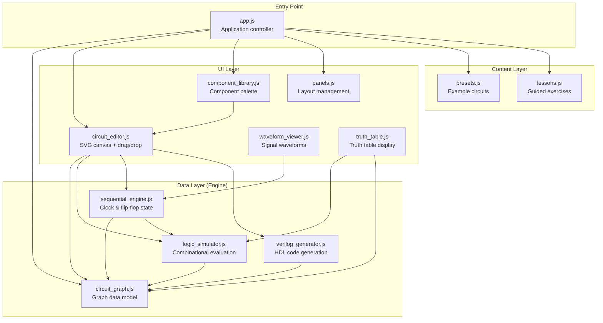

# RTL Playground — Implementation Plan

## Goal Description

Build **RTL Playground**, a self-contained, interactive educational web application that teaches beginners how RTL (Register-Transfer Level) descriptions correspond to digital logic circuits. Students will visually construct circuits, simulate their behavior in real-time, view auto-generated Verilog HDL, explore truth tables, visualize waveforms, and complete guided learning exercises.

This is a module of the **PD Playground** capstone project (alongside the existing STA Playground). It will be built as a standalone GitHub Pages–compatible application using **HTML, CSS, and vanilla JavaScript** — no frameworks, no backend, no build tools required.

### Context from PD Playground Paper
The capstone paper describes a cross-module educational platform covering RTL design → functional simulation → synthesis → gate-level representation → STA. RTL Playground is the first stage in this pipeline. The architecture must leave clean integration points for future synthesis/timing export, but must not fabricate delays or claim real technology-mapped synthesis.

---

## User Review Required

> [!IMPORTANT]
> **STA Repository Access**: I was unable to access `https://github.com/ppawar-7/sta-playground` — it may be private or the URL may differ. The plan is based on your detailed requirements and the capstone paper context. If you can share the repo or key files, I can further align patterns. The plan is designed to be consistent with the described STA architecture regardless.

> [!IMPORTANT]
> **Project Location**: The project will be created at `C:\Users\pranil\.gemini\antigravity\scratch\rtl-playground\`. I recommend setting this as your active workspace after creation. If you prefer a different location, please specify.

> [!IMPORTANT]
> **Scope Boundary**: This plan covers the full 4-phase build (combinational logic → Verilog/truth tables → sequential logic → lessons). The application will be functionally complete but uses a provisional UI that can be redesigned later. No external dependencies.

---

## Open Questions

> [!NOTE]
> **These have reasonable defaults — no blocking questions.** I'll proceed with the defaults below unless you specify otherwise.

1. **Signal naming convention**: Auto-generated names like `in0`, `in1`, `out0` with user-renamable labels. *(Default: yes)*
2. **Maximum circuit size**: Cap at ~20 components for the educational scope to keep simulation fast. *(Default: soft warning, no hard limit)*
3. **Wire routing style**: Manhattan (right-angle) routing vs. direct lines. *(Default: direct lines with slight curvature for clarity — simpler to implement and works well for educational circuits)*

---

## Architecture Overview



### Key Architectural Principles

1. **Circuit graph is the single source of truth** — all simulation, visualization, Verilog generation, and truth tables read from the same `CircuitGraph` data model
2. **Engine has zero DOM dependencies** — `circuit_graph.js`, `logic_simulator.js`, `sequential_engine.js`, and `verilog_generator.js` are pure JavaScript modules testable without a browser
3. **Event-driven updates** — circuit changes fire events; UI layers subscribe and re-render
4. **CSS custom properties** — all colors, spacing, and typography are themeable via variables

---

## Proposed Changes

### File Structure

```
rtl-playground/
├── index.html                    [NEW]
├── README.md                     [NEW]
├── src/
│   ├── app.js                    [NEW]  Application controller
│   ├── engine/
│   │   ├── circuit_graph.js      [NEW]  Graph data model
│   │   ├── logic_simulator.js    [NEW]  Combinational logic evaluation
│   │   ├── sequential_engine.js  [NEW]  Clock + flip-flop state machine
│   │   └── verilog_generator.js  [NEW]  Verilog HDL code generation
│   ├── ui/
│   │   ├── circuit_editor.js     [NEW]  SVG canvas, drag/drop, wiring
│   │   ├── component_library.js  [NEW]  Component palette sidebar
│   │   ├── waveform_viewer.js    [NEW]  Waveform display canvas
│   │   ├── truth_table.js        [NEW]  Truth table generator UI
│   │   └── panels.js             [NEW]  Layout & panel management
│   ├── modules/
│   │   ├── presets.js            [NEW]  Predefined example circuits
│   │   └── lessons.js            [NEW]  Learning exercises & validation
│   └── styles/
│       └── main.css              [NEW]  All styles with CSS variables
└── tests/
    └── test_runner.html          [NEW]  Browser-based test suite
    └── tests.js                  [NEW]  Automated engine + integration tests
```

---

### Phase 1 — Core Foundation

#### [NEW] `src/engine/circuit_graph.js`

The circuit graph is the central data model. Every component, pin, and connection lives here.

**Data structures:**

```javascript
// Component definition
{
    id: 'and_1',           // Unique identifier
    type: 'AND',           // Gate type enum
    label: 'AND Gate',     // Display label
    x: 200, y: 150,        // Canvas position
    inputs: [              // Input pins
        { id: 'in0', label: 'A', value: null, connectedTo: null },
        { id: 'in1', label: 'B', value: null, connectedTo: null }
    ],
    outputs: [             // Output pins
        { id: 'out0', label: 'Y', value: null }
    ]
}

// Connection definition
{
    id: 'conn_1',
    fromComponent: 'and_1',
    fromPin: 'out0',
    toComponent: 'or_1',
    toPin: 'in0'
}
```

**Key methods:**

| Method | Purpose |
|--------|---------|
| `addComponent(type, x, y)` | Create and register a new component |
| `removeComponent(id)` | Remove component and all its connections |
| `addConnection(from, fromPin, to, toPin)` | Wire two pins together |
| `removeConnection(id)` | Remove a wire |
| `getTopologicalOrder()` | Topological sort for evaluation order |
| `detectCycles()` | Find combinational feedback loops |
| `validateCircuit()` | Check for unconnected pins, multi-drivers |
| `getInputComponents()` | Get all INPUT type components |
| `getOutputComponents()` | Get all OUTPUT type components |
| `serialize()` / `deserialize()` | JSON export/import for presets |
| `clear()` | Reset entire circuit |

**Supported component types:**

```javascript
const COMPONENT_TYPES = {
    INPUT:  { inputs: 0, outputs: 1, evaluate: (vals) => vals },
    OUTPUT: { inputs: 1, outputs: 0, evaluate: (vals) => vals },
    AND:    { inputs: 2, outputs: 1, evaluate: ([a,b]) => a & b },
    OR:     { inputs: 2, outputs: 1, evaluate: ([a,b]) => a | b },
    NOT:    { inputs: 1, outputs: 1, evaluate: ([a]) => a ^ 1 },
    NAND:   { inputs: 2, outputs: 1, evaluate: ([a,b]) => (a & b) ^ 1 },
    NOR:    { inputs: 2, outputs: 1, evaluate: ([a,b]) => (a | b) ^ 1 },
    XOR:    { inputs: 2, outputs: 1, evaluate: ([a,b]) => a ^ b },
    XNOR:   { inputs: 2, outputs: 1, evaluate: ([a,b]) => (a ^ b) ^ 1 },
    MUX2:   { inputs: 3, outputs: 1, evaluate: ([a,b,sel]) => sel ? b : a },
    DFF:    { inputs: 2, outputs: 1, sequential: true },  // D, CLK → Q
    CLOCK:  { inputs: 0, outputs: 1, sequential: true }
};
```

**Cycle detection algorithm:**
Uses DFS with coloring (WHITE→GRAY→BLACK). A back edge (reaching a GRAY node) indicates a combinational cycle. Sequential elements (DFF) break the dependency chain — their Q output doesn't depend combinationally on their D input.

```javascript
detectCycles() {
    // Build adjacency list excluding DFF Q→D paths
    // DFS with 3-color marking
    // Returns { hasCycle: bool, cycleNodes: [...] }
}
```

**Multi-driver prevention:**
Each input pin tracks `connectedTo`. `addConnection()` rejects if the target input pin already has a connection (returns error with descriptive message).

---

#### [NEW] `src/engine/logic_simulator.js`

Pure combinational logic evaluator.

```javascript
class LogicSimulator {
    constructor(circuitGraph) { ... }

    // Full evaluation: topological sort → evaluate each node in order
    evaluate() {
        const order = this.graph.getTopologicalOrder();
        // returns { hasCycle: true, ... } if cycles detected
        for (const componentId of order) {
            this.evaluateComponent(componentId);
        }
        return this.getResults();
    }

    // Evaluate single component based on its input values
    evaluateComponent(id) {
        const comp = this.graph.getComponent(id);
        const inputValues = comp.inputs.map(pin => {
            if (pin.connectedTo) {
                return this.graph.getPinValue(pin.connectedTo);
            }
            return null; // unconnected
        });

        // Skip sequential components (handled by SequentialEngine)
        if (COMPONENT_TYPES[comp.type].sequential) return;

        const result = COMPONENT_TYPES[comp.type].evaluate(inputValues);
        comp.outputs[0].value = (inputValues.includes(null)) ? null : result;
    }

    // Evaluate with specific input values (for truth table generation)
    evaluateWithInputs(inputValues) {
        // Set INPUT component values, then evaluate()
        // Returns output values
    }
}
```

**Signal values:** `0`, `1`, or `null` (unresolved/unconnected). The `null` state propagates — any gate with a `null` input produces `null` output, providing clear visual feedback that something is unconnected.

---

#### [NEW] `src/ui/circuit_editor.js`

SVG-based interactive circuit canvas.

**Component rendering:**
Each gate type has an SVG template:

```javascript
// Example: AND gate SVG path
const GATE_SHAPES = {
    AND: {
        path: 'M 0 0 L 30 0 A 20 20 0 0 1 30 40 L 0 40 Z',
        width: 50, height: 40,
        inputPins: [{x: 0, y: 10}, {x: 0, y: 30}],
        outputPins: [{x: 50, y: 20}]
    },
    // ... other gates with standard digital logic symbols
};
```

**Interactions implemented:**

| Interaction | Implementation |
|-------------|---------------|
| **Add component** | Click palette → click canvas to place |
| **Drag component** | mousedown on component body → mousemove → mouseup |
| **Create wire** | mousedown on output pin → drag → release on input pin |
| **Toggle input** | Click on INPUT component toggles 0↔1 |
| **Delete component** | Select → Delete key or context button |
| **Delete wire** | Click on wire → Delete key or context button |
| **Select** | Click on component highlights it with selection border |

**Wire rendering:**
Wires are SVG `<path>` elements using quadratic Bézier curves for slight curvature:

```javascript
renderWire(conn) {
    const from = this.getPinPosition(conn.fromComponent, conn.fromPin);
    const to = this.getPinPosition(conn.toComponent, conn.toPin);
    const midX = (from.x + to.x) / 2;
    const d = `M ${from.x} ${from.y} Q ${midX} ${from.y} ${midX} ${(from.y+to.y)/2} Q ${midX} ${to.y} ${to.x} ${to.y}`;
    // Color based on signal value: green (1), gray (0), red dashed (null)
}
```

**Signal visualization colors:**

| Value | Wire Color | Pin Color |
|-------|-----------|-----------|
| `1` (HIGH) | `#22c55e` (green) | Filled green |
| `0` (LOW) | `#6b7280` (gray) | Filled gray |
| `null` (unresolved) | `#ef4444` (red dashed) | Red outline |

**Component SVG structure:**

```svg
<g class="component" data-id="and_1" transform="translate(200,150)">
  <!-- Gate body -->
  <path d="..." class="gate-body" />
  <!-- Label -->
  <text class="gate-label">AND</text>
  <!-- Input pins (circles) -->
  <circle class="pin input-pin" data-pin="in0" cx="0" cy="10" r="5" />
  <circle class="pin input-pin" data-pin="in1" cx="0" cy="30" r="5" />
  <!-- Output pin -->
  <circle class="pin output-pin" data-pin="out0" cx="50" cy="20" r="5" />
  <!-- Pin labels -->
  <text class="pin-label" x="-10" y="13">A</text>
  <text class="pin-label" x="-10" y="33">B</text>
  <text class="pin-label" x="58" y="23">Y</text>
</g>
```

---

#### [NEW] `src/ui/component_library.js`

Left sidebar component palette.

```html
<!-- Rendered structure -->
<div class="component-palette">
  <h3>Components</h3>
  <div class="palette-section">
    <h4>Inputs/Outputs</h4>
    <button class="palette-item" data-type="INPUT">
      <svg><!-- mini icon --></svg>
      <span>Input</span>
    </button>
    <button class="palette-item" data-type="OUTPUT">...</button>
    <button class="palette-item" data-type="CLOCK">...</button>
  </div>
  <div class="palette-section">
    <h4>Logic Gates</h4>
    <button class="palette-item" data-type="AND">...</button>
    <!-- AND, OR, NOT, NAND, NOR, XOR, XNOR -->
  </div>
  <div class="palette-section">
    <h4>Combinational</h4>
    <button class="palette-item" data-type="MUX2">...</button>
  </div>
  <div class="palette-section">
    <h4>Sequential</h4>
    <button class="palette-item" data-type="DFF">...</button>
  </div>
</div>
```

Each palette item shows a miniature SVG icon and label. Clicking selects the component type; the next click on the canvas places it.

---

#### [NEW] `src/ui/panels.js`

Layout management — creates the 3-panel + bottom tabbed layout.

```
┌──────────────┬────────────────────────────┬──────────────┐
│  Left Panel  │      Center: Circuit       │  Right Panel │
│  - Palette   │        Canvas (SVG)        │  - Info      │
│  - Lessons   │                            │  - Controls  │
│              │                            │  - I/O State │
├──────────────┴────────────────────────────┴──────────────┤
│  Bottom Tabs: [Verilog] [Truth Table] [Waveform]        │
│  ┌─────────────────────────────────────────────────────┐│
│  │  Tab content area                                   ││
│  └─────────────────────────────────────────────────────┘│
└─────────────────────────────────────────────────────────┘
```

Panels are resizable sections using CSS Grid. Bottom section uses a tab switcher.

---

#### [NEW] `src/styles/main.css`

Complete stylesheet with CSS custom properties for easy theming:

```css
:root {
    /* Color palette */
    --color-bg-primary: #0f172a;
    --color-bg-secondary: #1e293b;
    --color-bg-tertiary: #334155;
    --color-text-primary: #f1f5f9;
    --color-text-secondary: #94a3b8;
    --color-accent: #3b82f6;
    --color-accent-hover: #2563eb;
    --color-success: #22c55e;
    --color-warning: #f59e0b;
    --color-error: #ef4444;

    /* Signal colors */
    --color-signal-high: #22c55e;
    --color-signal-low: #6b7280;
    --color-signal-unknown: #ef4444;

    /* Layout */
    --panel-left-width: 240px;
    --panel-right-width: 280px;
    --panel-bottom-height: 250px;
    --header-height: 48px;

    /* Typography */
    --font-primary: 'Segoe UI', system-ui, -apple-system, sans-serif;
    --font-mono: 'Cascadia Code', 'Fira Code', 'Consolas', monospace;
    --font-size-sm: 0.8125rem;
    --font-size-base: 0.875rem;
    --font-size-lg: 1rem;

    /* Spacing */
    --spacing-xs: 4px;
    --spacing-sm: 8px;
    --spacing-md: 12px;
    --spacing-lg: 16px;
    --spacing-xl: 24px;

    /* Borders */
    --border-radius: 6px;
    --border-color: #334155;
}
```

Dark engineering theme inspired by EDA tool interfaces. Every visual property is a CSS variable for easy future reskinning.

---

#### [NEW] `index.html`

Single-page application entry point. Uses ES modules (`type="module"`) — no bundler needed.

```html
<!DOCTYPE html>
<html lang="en">
<head>
    <meta charset="UTF-8">
    <meta name="viewport" content="width=device-width, initial-scale=1.0">
    <title>RTL Playground — Interactive RTL Design Learning</title>
    <link rel="stylesheet" href="src/styles/main.css">
</head>
<body>
    <header class="app-header">
        <h1>RTL Playground</h1>
        <div class="header-actions">
            <select id="preset-select"><!-- populated by JS --></select>
            <button id="btn-reset">Reset Circuit</button>
        </div>
    </header>
    <main class="app-layout">
        <aside class="panel-left" id="panel-left"></aside>
        <section class="panel-center" id="panel-center">
            <svg id="circuit-canvas"></svg>
        </section>
        <aside class="panel-right" id="panel-right"></aside>
    </main>
    <section class="panel-bottom" id="panel-bottom">
        <div class="tab-bar" id="tab-bar"></div>
        <div class="tab-content" id="tab-content"></div>
    </section>
    <script type="module" src="src/app.js"></script>
</body>
</html>
```

---

#### [NEW] `src/app.js`

Application controller — wires up engine and UI layers.

```javascript
import { CircuitGraph } from './engine/circuit_graph.js';
import { LogicSimulator } from './engine/logic_simulator.js';
import { SequentialEngine } from './engine/sequential_engine.js';
import { VerilogGenerator } from './engine/verilog_generator.js';
import { CircuitEditor } from './ui/circuit_editor.js';
import { ComponentLibrary } from './ui/component_library.js';
import { WaveformViewer } from './ui/waveform_viewer.js';
import { TruthTable } from './ui/truth_table.js';
import { PanelManager } from './ui/panels.js';
import { PRESETS } from './modules/presets.js';
import { LessonManager } from './modules/lessons.js';

class RTLPlayground {
    constructor() {
        this.graph = new CircuitGraph();
        this.simulator = new LogicSimulator(this.graph);
        this.sequentialEngine = new SequentialEngine(this.graph, this.simulator);
        this.verilogGen = new VerilogGenerator(this.graph);

        // Initialize UI
        this.panels = new PanelManager();
        this.editor = new CircuitEditor('circuit-canvas', this.graph, this.simulator);
        this.library = new ComponentLibrary('panel-left', this.editor);
        this.waveform = new WaveformViewer('tab-content');
        this.truthTable = new TruthTable('tab-content', this.graph, this.simulator);
        this.lessons = new LessonManager('panel-left', this.graph, this.simulator, this.editor);

        this.setupEventHandlers();
        this.loadDefaultState();
    }

    setupEventHandlers() {
        // Circuit changes → re-simulate → update all views
        this.graph.on('change', () => {
            this.simulator.evaluate();
            this.editor.updateSignalVisualization();
            this.verilogGen.generate(); // updates Verilog panel
            this.updateInfoPanel();
        });

        // Preset loading
        document.getElementById('preset-select').addEventListener('change', (e) => {
            this.loadPreset(e.target.value);
        });

        // Reset
        document.getElementById('btn-reset').addEventListener('click', () => {
            this.graph.clear();
            this.editor.render();
        });
    }
}

document.addEventListener('DOMContentLoaded', () => {
    window.app = new RTLPlayground();
});
```

---

### Phase 2 — RTL Understanding

#### [NEW] `src/engine/verilog_generator.js`

Generates synthesizable Verilog from the circuit graph.

**Strategy:**
1. Identify all INPUT components → `input wire` declarations
2. Identify all OUTPUT components → `output wire` or `output reg` declarations
3. For each combinational output, trace back through the gate network to build a Boolean expression
4. For each sequential output (DFF Q), generate an `always @(posedge clk)` block
5. Use component labels as signal names (with sanitization)

**Expression builder:**

```javascript
buildExpression(componentId, pinId) {
    const comp = this.graph.getComponent(componentId);

    if (comp.type === 'INPUT') return this.sanitizeName(comp.label);

    const inputExprs = comp.inputs.map(pin => {
        if (!pin.connectedTo) return "'bx";
        return this.buildExpression(pin.connectedTo.componentId, pin.connectedTo.pinId);
    });

    switch (comp.type) {
        case 'AND':  return `(${inputExprs[0]} & ${inputExprs[1]})`;
        case 'OR':   return `(${inputExprs[0]} | ${inputExprs[1]})`;
        case 'NOT':  return `(~${inputExprs[0]})`;
        case 'NAND': return `(~(${inputExprs[0]} & ${inputExprs[1]}))`;
        case 'NOR':  return `(~(${inputExprs[0]} | ${inputExprs[1]}))`;
        case 'XOR':  return `(${inputExprs[0]} ^ ${inputExprs[1]})`;
        case 'XNOR': return `(~(${inputExprs[0]} ^ ${inputExprs[1]}))`;
        case 'MUX2': return `(${inputExprs[2]} ? ${inputExprs[1]} : ${inputExprs[0]})`;
    }
}
```

**Example output for a half adder:**

```verilog
module circuit (
    input wire a,
    input wire b,
    output wire sum,
    output wire carry
);

assign sum = (a ^ b);
assign carry = (a & b);

endmodule
```

**Verilog display panel:**
- Syntax highlighting via CSS classes (keywords blue, signals green, operators white)
- Simple regex-based tokenizer — not a full parser, just for display coloring
- Copy-to-clipboard button

---

#### [NEW] `src/ui/truth_table.js`

Generates and displays truth tables for combinational circuits.

**Algorithm:**
1. Count INPUT components (limit: ≤4 for 16-row table; ≤6 with warning)
2. Enumerate all 2^n input combinations
3. For each combination, set INPUT values and call `simulator.evaluateWithInputs()`
4. Collect OUTPUT values
5. Render as HTML table

```javascript
class TruthTable {
    generate() {
        const inputs = this.graph.getInputComponents();
        const outputs = this.graph.getOutputComponents();

        if (inputs.length > 4) {
            this.showWarning(`${inputs.length} inputs → ${2**inputs.length} rows. Showing first 16.`);
        }

        const rows = [];
        const n = Math.min(inputs.length, 6);
        for (let i = 0; i < (1 << n); i++) {
            const inputVals = {};
            inputs.forEach((inp, idx) => {
                inputVals[inp.id] = (i >> (n - 1 - idx)) & 1;
            });
            const result = this.simulator.evaluateWithInputs(inputVals);
            rows.push({ inputs: inputVals, outputs: result });
        }

        this.renderTable(inputs, outputs, rows);
    }
}
```

**Table styling:** Monospace font, alternating row colors, highlighted current input combination (matching the canvas state).

---

#### [NEW] `src/modules/presets.js`

Predefined example circuits as serialized `CircuitGraph` data.

**Included presets:**

| Preset | Components | Educational Purpose |
|--------|-----------|---------------------|
| **AND Gate** | 2 inputs + AND + output | Simplest circuit, test basic wiring |
| **Half Adder** | 2 inputs + XOR + AND + 2 outputs | First multi-gate circuit |
| **Full Adder** | 3 inputs + XOR×2 + AND×2 + OR + 2 outputs | Larger combinational design |
| **2:1 Multiplexer** | 3 inputs + MUX2 + output | Selection logic |
| **SR Latch (NOR)** | 2 inputs + NOR×2 + 2 outputs | Cross-coupled gates (cycle detection demo) |
| **D Flip-Flop Demo** | D input + Clock + DFF + output | Sequential logic introduction |

Each preset is a JSON-serializable object:

```javascript
export const PRESETS = {
    'half-adder': {
        name: 'Half Adder',
        description: 'Computes SUM (XOR) and CARRY (AND) of two bits',
        components: [ ... ],
        connections: [ ... ]
    },
    // ...
};
```

---

### Phase 3 — Sequential Logic

#### [NEW] `src/engine/sequential_engine.js`

Manages clock state and flip-flop behavior.

```javascript
class SequentialEngine {
    constructor(graph, simulator) {
        this.graph = graph;
        this.simulator = simulator;
        this.clockState = 0;           // Current clock value
        this.stepCount = 0;            // Total clock steps
        this.dffStates = new Map();    // componentId → { Q: 0|1, D_sampled: 0|1 }
        this.waveformHistory = [];     // Array of signal snapshots
    }

    // Positive-edge-triggered clock step
    clockStep() {
        const prevClock = this.clockState;
        this.clockState = this.clockState ^ 1; // Toggle

        // Update CLOCK component output
        this.updateClockComponents();

        // On rising edge (0 → 1): sample D, update Q
        if (prevClock === 0 && this.clockState === 1) {
            this.processingRisingEdge();
        }

        // Re-evaluate combinational logic with new Q values
        this.simulator.evaluate();
        this.recordWaveform();
        this.stepCount++;
    }

    processingRisingEdge() {
        for (const [id, state] of this.dffStates) {
            const comp = this.graph.getComponent(id);
            const dPin = comp.inputs[0]; // D input
            const dValue = this.graph.getPinValue(dPin.connectedTo);
            state.Q = (dValue !== null) ? dValue : state.Q;
            // Update Q output pin
            comp.outputs[0].value = state.Q;
        }
    }

    recordWaveform() {
        // Snapshot all signal values for waveform display
        const snapshot = {
            step: this.stepCount,
            clock: this.clockState,
            signals: {}
        };
        // Record DFF D and Q values, plus any other tracked signals
        this.waveformHistory.push(snapshot);
    }

    reset() {
        this.clockState = 0;
        this.stepCount = 0;
        this.dffStates.forEach(state => { state.Q = 0; });
        this.waveformHistory = [];
    }
}
```

**Key behavior:**
- Clock toggles on each `clockStep()` call
- DFF updates Q **only** on rising edge (0→1 transition)
- Between rising edges, Q retains its previous value
- Combinational logic is re-evaluated after every clock toggle

---

#### [NEW] `src/ui/waveform_viewer.js`

Canvas-based waveform display.

```
Step:  0   1   2   3   4   5   6   7
CLK:  ─┐  ┌─┐ ┌─┐ ┌─┐ ┌─┐ ┌─┐ ┌─┐ ┌
      0│  │1│ │0│ │1│ │0│ │1│ │0│ │1
       └──┘ └─┘ └─┘ └─┘ └─┘ └─┘ └─┘

D:    ───────┐     ┌────────────┐
      0      │  1  │     0      │  1
             └─────┘            └────

Q:    ──────────┐        ┌──────────
      0         │   1    │     0
                └────────┘
```

**Implementation:**
- HTML5 Canvas rendering
- Signal names on the left, waveforms on the right
- Step markers on top
- Rising/falling edges shown as vertical transitions
- Current step highlighted
- Configurable number of visible steps (default: 16)
- Manual "Clock Step" button and "Auto-Run" toggle (200ms interval)

**Controls:**
- **Step** button: advances one clock toggle
- **Run/Stop** toggle: auto-steps at configurable speed
- **Reset** button: clears waveform history and resets DFF state
- **Steps visible** slider: 8–32 steps

---

### Phase 4 — Educational Lessons

#### [NEW] `src/modules/lessons.js`

Interactive guided exercises with behavioral validation.

**Lesson data structure:**

```javascript
const LESSONS = [
    {
        id: 'logic-gates',
        title: 'Understanding Logic Gates',
        difficulty: 'Beginner',
        description: 'Learn how basic logic gates process binary signals.',
        objective: 'Build an AND gate circuit and verify its truth table.',
        explanation: `
            Logic gates are the building blocks of digital circuits.
            An AND gate outputs 1 only when ALL inputs are 1.
            ...
        `,
        starterCircuit: null, // Empty canvas — student builds from scratch
        task: 'Create a circuit with 2 inputs, 1 AND gate, and 1 output. Connect them and verify the truth table.',
        hints: [
            'Start by adding two INPUT components',
            'Add an AND gate from the Logic Gates section',
            'Connect each input to the AND gate',
            'Add an OUTPUT and connect it to the AND gate output'
        ],
        validate: (graph, simulator) => {
            // Behavioral validation — test all input combinations
            const inputs = graph.getInputComponents();
            const outputs = graph.getOutputComponents();
            if (inputs.length < 2 || outputs.length < 1) {
                return { pass: false, message: 'Need at least 2 inputs and 1 output.' };
            }

            // Test AND truth table: only (1,1) → 1
            const tests = [[0,0,0], [0,1,0], [1,0,0], [1,1,1]];
            for (const [a, b, expected] of tests) {
                const result = simulator.evaluateWithInputs({
                    [inputs[0].id]: a,
                    [inputs[1].id]: b
                });
                const actual = result[outputs[0].id];
                if (actual !== expected) {
                    return {
                        pass: false,
                        message: `For inputs A=${a}, B=${b}: expected ${expected} but got ${actual}.`
                    };
                }
            }
            return { pass: true, message: 'Correct! Your AND gate works perfectly.' };
        }
    },
    // Lesson 2: Half Adder
    {
        id: 'half-adder',
        title: 'Building a Half Adder',
        objective: 'Build a circuit that computes SUM and CARRY of two 1-bit inputs.',
        // ... validates SUM = A⊕B and CARRY = A·B for all input combinations
    },
    // Lesson 3: 2:1 Multiplexer
    {
        id: 'multiplexer',
        title: 'Understanding a 2:1 Multiplexer',
        starterCircuit: 'mux-starter', // Provides inputs, students build logic
        // ... validates Y = SEL ? B : A
    },
    // Lesson 4: D Flip-Flop
    {
        id: 'dff-intro',
        title: 'Introduction to Sequential Logic',
        starterCircuit: 'dff-demo', // Pre-built DFF circuit
        task: 'Step through the clock and observe how Q follows D only on rising edges.',
        // ... validates understanding through guided observation + quiz
    }
];
```

**Behavioral validation approach:**
- Lessons check the circuit's **input/output behavior**, not its internal structure
- A student who builds AND using NAND+NOT would still pass the AND gate lesson
- For the sequential lesson, validation checks that Q matches expected values after a sequence of clock steps with specified D inputs

**Lesson UI:**

```
┌─────────────────────────────┐
│ Lesson 1: Logic Gates       │
│ ────────────────────────── │
│ 📖 Logic gates are the     │
│ building blocks...          │
│                             │
│ 🎯 Objective:              │
│ Build an AND gate circuit   │
│                             │
│ 📝 Task:                   │
│ Create 2 inputs + AND gate  │
│ + output, wire them up.     │
│                             │
│ [💡 Hint]  [✓ Check]       │
│ [↺ Reset]  [→ Next Lesson] │
│                             │
│ ┌─────────────────────────┐│
│ │ ✅ Correct! Your AND    ││
│ │ gate works perfectly.   ││
│ └─────────────────────────┘│
└─────────────────────────────┘
```

---

### Testing

#### [NEW] `tests/test_runner.html`

Browser-based test runner — opens in a browser, runs all tests, shows pass/fail results.

#### [NEW] `tests/tests.js`

Comprehensive automated test suite. **No external test framework** — uses a simple custom assertion library (consistent with the no-dependency philosophy).

**Test categories and specific test cases:**

```javascript
// ═══════════════════════════════════════════
// 1. BASIC GATE TRUTH TABLES
// ═══════════════════════════════════════════

test('AND gate: all input combinations', () => {
    // [0,0]→0, [0,1]→0, [1,0]→0, [1,1]→1
});

test('OR gate: all input combinations', () => {
    // [0,0]→0, [0,1]→1, [1,0]→1, [1,1]→1
});

test('NOT gate: inversion', () => {
    // [0]→1, [1]→0
});

test('NAND gate: all input combinations', () => { ... });
test('NOR gate: all input combinations', () => { ... });
test('XOR gate: all input combinations', () => { ... });
test('XNOR gate: all input combinations', () => { ... });

// ═══════════════════════════════════════════
// 2. HALF ADDER
// ═══════════════════════════════════════════

test('Half adder: SUM = XOR, CARRY = AND', () => {
    // Build: 2 inputs → XOR → sum_output, same 2 inputs → AND → carry_output
    // Test: [0,0]→(0,0), [0,1]→(1,0), [1,0]→(1,0), [1,1]→(0,1)
});

// ═══════════════════════════════════════════
// 3. MULTIPLEXER
// ═══════════════════════════════════════════

test('2:1 MUX: sel=0 selects A, sel=1 selects B', () => {
    // All 8 input combinations for (A, B, SEL)
});

// ═══════════════════════════════════════════
// 4. MULTI-GATE SIGNAL PROPAGATION
// ═══════════════════════════════════════════

test('Cascaded gates: NOT → AND', () => {
    // Input A → NOT → AND(with B) → Output
    // Verify: A=0,B=1 → NOT(0)=1 → AND(1,1)=1
});

test('Fan-out: one output drives multiple inputs', () => {
    // One INPUT → (AND input 0, OR input 0)
});

// ═══════════════════════════════════════════
// 5. D FLIP-FLOP — SEQUENTIAL
// ═══════════════════════════════════════════

test('DFF: Q updates on rising edge only', () => {
    // Set D=1, step clock 0→1 (rising): Q should become 1
    // Set D=0, step clock 1→0 (falling): Q should remain 1
    // Step clock 0→1 (rising): Q should become 0
});

test('DFF: state retention between edges', () => {
    // Set D=1, rising edge → Q=1
    // Change D=0 (no clock edge): Q remains 1
});

// ═══════════════════════════════════════════
// 6. CYCLE DETECTION
// ═══════════════════════════════════════════

test('Combinational cycle detected', () => {
    // AND output → NOT input → AND input (feedback loop)
    // Should report cycle
});

test('DFF breaks combinational cycle', () => {
    // Feedback through DFF is allowed (sequential feedback)
});

// ═══════════════════════════════════════════
// 7. INVALID CONNECTIONS
// ═══════════════════════════════════════════

test('Multi-driver rejected', () => {
    // Two outputs driving same input pin → error
});

test('Unconnected inputs produce null output', () => {
    // AND gate with one unconnected input → null
});

// ═══════════════════════════════════════════
// 8. TRUTH TABLE CONSISTENCY
// ═══════════════════════════════════════════

test('Truth table matches simulation for half adder', () => {
    // Generate truth table, compare each row with direct simulation
});

// ═══════════════════════════════════════════
// 9. VERILOG GENERATION
// ═══════════════════════════════════════════

test('AND gate Verilog output', () => {
    // Should contain: assign y = (a & b);
});

test('Half adder Verilog output', () => {
    // Should contain both assign statements
});

test('DFF generates always block', () => {
    // Should contain: always @(posedge clk)
});

test('Verilog has valid module declaration', () => {
    // Check: module name, input/output ports, endmodule
});
```

**Total: ~25 test cases** covering all required verification areas.

---

### [NEW] `README.md`

Professional README with:
- Project overview and screenshots placeholder
- Quick start (open `index.html` in browser)
- Architecture diagram
- Feature list with status indicators
- How to run tests
- Limitations and future work
- Contributing guidelines
- License
- Credits (PD Playground capstone project attribution)

---

## Implementation Sequence

```mermaid
flowchart LR
    subgraph "Phase 1: Core Foundation"
        A1["circuit_graph.js"] --> A2["logic_simulator.js"]
        A2 --> A3["circuit_editor.js"]
        A3 --> A4["component_library.js"]
        A4 --> A5["panels.js + main.css"]
        A5 --> A6["app.js + index.html"]
        A6 --> A7["Phase 1 Tests"]
    end

    subgraph "Phase 2: RTL Understanding"
        B1["verilog_generator.js"] --> B2["truth_table.js"]
        B2 --> B3["presets.js"]
        B3 --> B4["Phase 2 Tests"]
    end

    subgraph "Phase 3: Sequential Logic"
        C1["sequential_engine.js"] --> C2["waveform_viewer.js"]
        C2 --> C3["DFF + Clock in editor"]
        C3 --> C4["Phase 3 Tests"]
    end

    subgraph "Phase 4: Education"
        D1["lessons.js"] --> D2["Lesson UI in panels"]
        D2 --> D3["All Tests + Fix"]
        D3 --> D4["README.md"]
    end

    A7 --> B1
    B4 --> C1
    C4 --> D1
```



Each phase is **tested before proceeding** to the next.

---

## Verification Plan

### Automated Tests

```bash
# Open test runner in browser:
# Navigate to rtl-playground/tests/test_runner.html

# Or run via Node.js if available (engine tests only):
node tests/tests.js
```

The test suite uses a minimal custom framework:
- `test(name, fn)` — registers a test
- `assert(condition, message)` — throws on failure
- `assertEqual(actual, expected)` — value comparison
- Results displayed as ✅/❌ with error details

All ~25 tests must pass before delivery.

### Manual Verification

The user should verify:

1. **Open `index.html`** in Chrome/Firefox — no console errors
2. **Build a simple circuit**: Add 2 inputs → AND gate → output → connect all wires
3. **Toggle inputs**: Click input toggles 0/1, output updates immediately, wires change color
4. **Check Verilog tab**: Shows valid `assign y = (a & b);`
5. **Check Truth Table tab**: Shows correct 4-row AND truth table
6. **Load Half Adder preset**: Circuit loads with correct layout and behavior
7. **Test DFF**: Load DFF preset, step clock, verify Q follows D on rising edges only
8. **Waveform**: Shows CLK, D, Q waveforms matching simulation
9. **Complete Lesson 1**: Build AND gate, click Check, get "Correct" feedback
10. **Responsive layout**: Window resize doesn't break panels

### Known Limitations (to be documented)

- Single-bit signals only (no buses/vectors)
- No arbitrary Verilog parsing or user-written HDL simulation
- No real propagation delays or technology-mapped synthesis
- Component limit is soft (educational scope, not a performance boundary)
- Wire routing is basic (no auto-routing or congestion avoidance)
- Sequential simulation is step-based, not continuous time
- No undo/redo (future enhancement)

---

## Future Integration Points

The `CircuitGraph.serialize()` method exports a clean JSON representation that can be consumed by future synthesis and STA modules:

```javascript
// Future export format for synthesis stage
{
    components: [...],
    connections: [...],
    metadata: {
        hasSequentialLogic: true,
        inputCount: 3,
        outputCount: 2,
        gateCount: 5
    }
}
```

This is intentionally minimal — no fabricated timing data. The STA Playground integration will add its own delay model on top of this structural representation.
