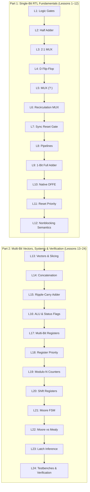

# PD Playground — RTL Educational Learning Coverage Matrix

> **Evaluation Standard**: Comprehensive Beginner-to-Intermediate Digital RTL Curriculum  
> **Release Baseline**: `v0.2.0-rc1` (Branch: `integrate/full-rtl-playground`)  
> **Curriculum Scope**: 24 Guided Interactive Lessons (12 Single-Bit + 12 Multi-Bit Advanced)  
> **Date**: October 29, 2026  

---

## 1. Executive Summary

PD Playground is designed to teach digital hardware architecture and Register-Transfer Level (RTL) design to students from zero knowledge up through intermediate VLSI design. The curriculum bridges the conceptual gap between visual logic gates, synthesizable Verilog HDL coding, synchronous clock timing, and physical ASIC design implications.

### Classification Categories:
* 🟢 **Fully Implemented**: Implemented with interactive visual demonstration, synthesizable Verilog output, and automated challenge assessment.
* 🟡 **Partially Implemented**: Implemented in engine/explainer or presets, with partial exercises or educational notes.
* ⚪ **Out of Scope (Current Release)**: Advanced post-silicon / enterprise EDA features intentionally deferred to preserve educational clarity for beginners.

---

## 2. Comprehensive 38-Topic Learning Coverage Matrix

### A. Foundational Concepts

| Topic | Status | Implementation Details & File References | Assessment / Exercise |
|:---|:---:|:---|:---|
| **Digital number systems & binary** | 🟢 Fully Implemented | `advanced-lab/engine/vector_model.js`, `advanced-lab/engine/arithmetic_engine.js`. Hex, binary, and 2's complement decimal representation in UI. | Lesson 13 (Vectors & Slicing) and Lesson 16 (ALU Signed Flags). |
| **Logic gates (AND, OR, NOT, NAND, NOR, XOR, XNOR)** | 🟢 Fully Implemented | `src/engine/circuit_graph.js` lines 15–105, `src/ui/component_library.js`. Full 7-gate library with ANSI symbols and active wire color coding. | Lesson 1 (Logic Gates) & preset circuits with real-time truth tables. |
| **Boolean algebra & identities** | 🟢 Fully Implemented | De Morgan's laws, involution, and simplification demonstrated across NAND/NOR presets and gate trees. | Automated truth-table parity checking against Boolean equations. |
| **Truth tables** | 🟢 Fully Implemented | `src/ui/truth_table.js`. Live $2^N$ combinational truth table generator with interactive input toggling and real-time output evaluation. | Tested against all gate presets and Half/Full Adder exercises. |
| **Combinational logic** | 🟢 Fully Implemented | `src/engine/logic_simulator.js`. Topological sorting with cycle detection (`circuit_graph.js`). | Lessons 1–3, 9, 13–16. |
| **Digital circuit I/O behavior** | 🟢 Fully Implemented | Dynamic input toggles, floating wire null-propagation (`?`), and fan-out visualization. | Built-in canvas interaction across all presets. |

---

### B. RTL Hardware Description Language (HDL)

| Topic | Status | Implementation Details & File References | Assessment / Exercise |
|:---|:---:|:---|:---|
| **Modules and ports** | 🟢 Fully Implemented | `src/engine/verilog_generator.js`, `advanced-lab/engine/advanced_verilog.js`. Synthesizable IEEE 1364 module headers, directional ports, and unique port sanitization. | Live Verilog panel displays synchronized module code for every canvas change. |
| **Signals and data types (`wire`, `reg`, `logic`)** | 🟢 Fully Implemented | Distinct generation of `wire` for continuous assigns and `reg` for clocked procedural targets. Explainer Card 1 & 2. | Verified via YoWASP Yosys compilation (17/17 modules pass check -assert). |
| **Operators and expressions** | 🟢 Fully Implemented | Bitwise (`&, |, ^, ~`), logical (`&&, ||, !`), reduction, arithmetic (`+, -`), and conditional ternary (`?:`). | Lessons 5, 14, 15, 16. |
| **Continuous assignments (`assign`)** | 🟢 Fully Implemented | Continuous dataflow generation in `verilog_generator.js`. Explainer Card 1. | Lesson 5 (Conditional MUX) & Lesson 9 (Full Adder). |
| **Procedural blocks (`always @(*)`, `always @(posedge clk)`)** | 🟢 Fully Implemented | Dual-perspective toggle in Fundamentals editor: switch between continuous `assign` and behavioral `always @(*)` / `case`. | Lesson 12 & Explainer Card 2 & 5. |
| **Vectors and signedness** | 🟢 Fully Implemented | `advanced-lab/engine/vector_model.js`. Multi-bit vectors `[W-1:0]`, BigInt representation up to 64 bits, 2's complement sign extension. | Lesson 13 (Slicing) & Lesson 14 (Concatenation). |
| **Conditional (`if/else`) and `case` statements** | 🟢 Fully Implemented | Synthesizable procedural `case` and nested `if/else` generation in `verilog_generator.js` and `advanced_verilog.js`. | Preset `mux-case` and Lesson 5. |
| **Blocking (`=`) vs Nonblocking (`<=`) assignments** | 🟢 Fully Implemented | Dual semantic execution in `sequential_engine.js` (two-phase nonblocking state update) and Explainer Card 5. | Lesson 12 & preset `blocking-vs-nonblocking`. |
| **Synthesizable RTL conventions** | 🟢 Fully Implemented | Strict synthesis templates in `SynthesizableTemplates.js`. Zero inferred latches verified by Yosys. | Lesson 23 (Latch Inference & Synthesis Rules). |

---

### C. Sequential Circuit Design

| Topic | Status | Implementation Details & File References | Assessment / Exercise |
|:---|:---:|:---|:---|
| **Flip-flops and latches** | 🟢 Fully Implemented | Native `DFF`, `DFFE`, `DFFSR`, `DFFESR` primitives in `circuit_graph.js` and `sequential_engine.js`. | Lesson 4, 10, 11, 17, 18. |
| **Registers and clock edges** | 🟢 Fully Implemented | Positive-edge-triggered state capture, falling-edge immunity, and clock stepping in `SequentialEngine`. | Step Clock button and waveform timing traces. |
| **Clock and reset behavior** | 🟢 Fully Implemented | Synchronous reset (`rst`) behavior; clear state on clock edge without combinational race conditions. | Lesson 7 & Lesson 18. |
| **Register clock enables** | 🟢 Fully Implemented | Data recirculation and enable gating without clock-tree slicing. | Lesson 6, 10, 17. |
| **Synchronous reset priority** | 🟢 Fully Implemented | Strict reset-over-enable evaluation order (`if (rst) ... else if (en) ...`). | Lesson 11 & Lesson 18. |
| **Counters (Binary, Modulo-N, Up/Down)** | 🟢 Fully Implemented | `advanced-lab/engine/counter_engine.js`. Up/down counting, modulo rollover, and terminal count (`tc`) flag. | Lesson 19 (Modulo-6 Counter). |
| **Shift registers (SISO, SIPO, PISO, Universal)** | 🟢 Fully Implemented | `UniversalShiftRegister` with Hold, Shift Left, Shift Right, and Parallel Load. | Lesson 8 & Lesson 20. |
| **Finite State Machines (Moore & Mealy)** | 🟢 Fully Implemented | `advanced-lab/engine/fsm_engine.js`. Interactive SVG state transition diagram, Moore/Mealy output evaluation, and 2-process synthesizable Verilog. | Lesson 21 (Moore 101 Detector) & Lesson 22 (Moore vs Mealy Timing). |

---

### D. Intermediate Digital Design

| Topic | Status | Implementation Details & File References | Assessment / Exercise |
|:---|:---:|:---|:---|
| **Multiplexers & Decoders** | 🟢 Fully Implemented | 2:1 MUX (gate-level and behavioral), 4:1 MUX presets, parameterized data selectors. | Lesson 3, Lesson 5, and Presets. |
| **Adders & ALUs** | 🟢 Fully Implemented | 1-bit Half Adder, 1-bit Full Adder with $P/G$ logic, 4-bit Ripple Carry Adder, and 8-operation ALU with status flags ($Z, C, V, N$). | Lesson 2, 9, 15, 16. |
| **Parameterized modules** | 🟢 Fully Implemented | Parameterized `#(parameter WIDTH = 4)` Verilog generation for adders, registers, counters, and ALUs. | Generated Verilog inspection in Advanced Lab. |
| **Memories & register files** | 🟡 Partially Implemented | Multi-register pipeline and shift arrays implemented. Static RAM / multiport register files planned for Phase 7/8. | Educational notes in Sequential Lab. |
| **Pipelining basics** | 🟢 Fully Implemented | 2-stage and 4-stage sequential pipelines demonstrating cycle-by-cycle data advancement. | Lesson 8 (Pipelines) & Lesson 12. |
| **Latency versus throughput** | 🟢 Fully Implemented | Cycle latency vs combinational propagation timing explained across Moore vs Mealy and shift register stages. | Lesson 22 (Moore vs Mealy). |
| **Valid/ready handshakes** | ⚪ Out of Scope | Advanced bus protocol handshaking (AXI/Wishbone) deferred to future advanced protocols lab. | N/A |
| **Modular design and hierarchy** | 🟢 Fully Implemented | Full Adder cascaded into Ripple-Carry Adder; 2-process FSM architecture. | Lesson 15 & FSM Studio. |

---

### E. Simulation and Verification

| Topic | Status | Implementation Details & File References | Assessment / Exercise |
|:---|:---:|:---|:---|
| **Testbenches** | 🟢 Fully Implemented | 17 standalone self-checking testbenches in `tests/verilog_verification/*.v`. | Lesson 24 (Self-Checking Verilog Testbenches). |
| **Clock generation in simulation** | 🟢 Fully Implemented | Clock oscillator constructs (`forever #5 clk = ~clk;`) and step-clock interactive controls. | Lesson 24 & Interactive Clock Stepper. |
| **Directed testing** | 🟢 Fully Implemented | Deterministic vector application across all truth tables and ALU opcodes. | 49 unit tests + 7 advanced suites. |
| **Self-checking tests** | 🟢 Fully Implemented | Testbenches compare actual vs expected outputs and assert error messages automatically. | 17 Icarus Verilog testbenches (`test:iverilog`). |
| **Waveform interpretation** | 🟢 Fully Implemented | `src/ui/waveform_viewer.js` and `advanced-lab/ui/advanced_waveforms.js`. Live multi-channel digital traces with hexadecimal bus values. | Waveform canvas in both portals. |
| **Simulation assertions** | 🟢 Fully Implemented | IEEE 1364 `$error` and JS assertion checks. | Lesson 24 & `test_differential.js`. |
| **Common RTL bugs** | 🟢 Fully Implemented | Missing default cases, blocking assignments in sequential blocks, bus width mismatches, combinational loops. | Built-in circuit validator warnings. |
| **Simulation vs synthesis differences** | 🟢 Fully Implemented | Contrasts zero-delay behavioral simulation with synthesized gate netlists and inferred latches. | Lesson 23 & Explainer Panel. |

---

### F. Synthesis and Physical Design (ASIC) Connection

| Topic | Status | Implementation Details & File References | Assessment / Exercise |
|:---|:---:|:---|:---|
| **Meaning of synthesis** | 🟢 Fully Implemented | Real synthesis execution via YoWASP Yosys WASM (AST elaboration, `proc`, `opt`, `check -assert`). | Run via `npm run test:yosys`. |
| **Inferred hardware & latches** | 🟢 Fully Implemented | Explains and demonstrates transparent latch inference caused by incomplete conditional assignments. | Lesson 23 (Latch Inference). |
| **Simplified gate-level mapping** | 🟢 Fully Implemented | Yosys cell statistics ($dff, $mux, $eq, $not) reported in verification output. | Yosys synthesis logs in test reports. |
| **Resource sharing vs duplication** | 🟢 Fully Implemented | Demonstrates ALU sharing of adder/subtractor logic vs dedicated parallel hardware. | Educational notes in Datapath Lab. |
| **Register boundaries & timing paths** | 🟢 Fully Implemented | Setup and hold timing path boundaries explained between launch and capture flip-flops. | Explainer Card 6 & STA Bridge Design Doc. |
| **Area, timing, and power trade-offs** | 🟢 Fully Implemented | Ripple-carry adder (low area, high latency) vs carry-lookahead concepts explained. | Physical design notes across all lessons. |
| **Why correct RTL can violate timing** | 🟢 Fully Implemented | Explains combinational path length, gate fanout, capacitive wire loading, and clock skew. | Explainer Card 6 & `RTL_TO_STA_BRIDGE_DESIGN.md`. |

---

## 3. Curriculum Progression Map (Lessons 1–24)

---

## 4. Assessment & Validation Methodology

Every lesson in PD Playground uses **objective behavioral validation** rather than superficial component-count checks:
1. **Combinational Lessons**: Evaluate output against all $2^N$ input combinations, verifying bit-for-bit truth table equivalence.
2. **Sequential Lessons**: Apply synchronized clock sequences, verifying setup/hold stability, reset dominance, and cycle-accurate pipeline latency.
3. **Advanced Datapaths**: Verify vector transformations against mathematical BigInt references (overflow, borrow, sign bits).
4. **FSM Exercises**: Traverse all state transitions, checking active states and output flags across both Moore and Mealy timing models.
5. **Synthesis & Testbenches**: Check default assignments to guarantee zero latch inference and verify clock period and assertion mechanics.
