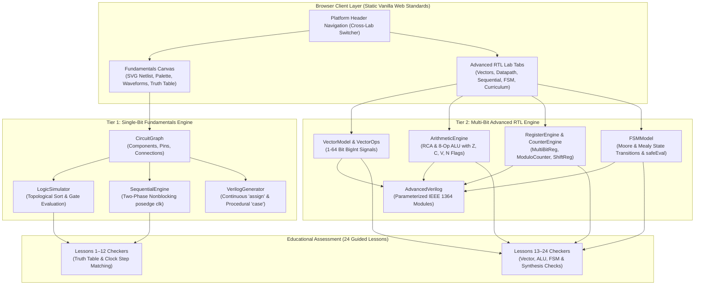

# PD Playground — System Architecture Deep Dive

> **Platform**: PD Playground (RTL Fundamentals & Advanced RTL Lab)  
> **Release Baseline**: `v0.2.0-rc1`  
> **Authoritative Architecture Reference**: October 29, 2026  
> **Target Audience**: Hardware Engineers, Verification Engineers, Software Architects, and Educational Platform Contributors

---

## 1. Architectural Philosophy: The Dual-Lab Design

PD Playground is designed around a fundamental pedagogical reality of digital VLSI education:
- **Single-Bit Gate & Register Fundamentals** (`index.html`): Students best internalize Boolean algebra, truth tables, gate pinouts, half adders, multiplexers, and flip-flop timing when visually placing discrete gates and drawing explicit wires between pins on a schematic canvas.
- **Multi-Bit Datapaths & Controllers** (`advanced-lab/index.html`): Attempting to draw a 16-bit ALU, 32-bit register bank, or complex finite state machine as hundreds of individual single-bit visual wires results in visual clutter that obscures architectural concepts. For vector architectures, students need specialized datapath visualizations (carry chains, bit-slice strips, hexadecimal bus waveforms, and interactive state transition graphs).

To maintain technical excellence and avoid unmaintainable monoliths, PD Playground separates these into **two clean architectural tiers** while preserving unified cross-lab navigation, shared verification tools, and a coherent 24-lesson curriculum.

---

## 2. Complete System Subsystem Inventory

### 2.1 Tier 1: Single-Bit Fundamentals Subsystems

#### A. Circuit Graph (`src/engine/circuit_graph.js`)
- **Purpose**: Canonical single-source-of-truth data model for single-bit circuits. Represents discrete components, pins, and wire connections.
- **Why It Exists**: Decouples the digital logic representation completely from the SVG/DOM canvas so logic evaluation can run headlessly in Node.js, Web Workers, or CI runners.
- **Key Files**: `src/engine/circuit_graph.js`
- **Input Data Structures**: Component instantiation specs `{ id, type, x, y, label, value }`. Connection requests `{ from: { componentId, pinIndex }, to: { componentId, pinIndex } }`.
- **Output Data Structures**: JSON-serializable graph object `{ components: [...], connections: [...] }`.
- **Internal State**: `components` (Map of ID to Component), `connections` (Array of Connections), `_eventListeners` (Map of event names to callback arrays).
- **Public API**:
  - `addComponent(type, x, y, options)`: Returns new Component instance.
  - `removeComponent(id)`: Removes component and cascading wires.
  - `addConnection(from, to)`: Validates and adds directional net.
  - `removeConnection(connectionId)`: Removes wire.
  - `getTopologicalOrder()`: Computes Kahn's algorithm topological sort, returns `{ ok, order, cycleNodes }`.
  - `serialize()` / `deserialize(data)`: Lossless JSON export/import.
- **Dependencies**: None (100% vanilla ES module, zero external imports).
- **Error Handling**: Rejects multi-driver nets, self-loops, and invalid pin indices; returns descriptive error strings without crashing.
- **Limitations**: Restricted to single-bit pins (`width = 1`). Floating inputs evaluate to `null` (unconnected).

#### B. Combinational Logic Simulator (`src/engine/logic_simulator.js`)
- **Purpose**: Evaluates combinational Boolean logic across the netlist graph.
- **Why It Exists**: Computes steady-state logic propagation without simulation race conditions.
- **Key Files**: `src/engine/logic_simulator.js`
- **Input Data Structures**: Current values on `INPUT` component output pins.
- **Output Data Structures**: Updated `value` properties on all component input and output pins.
- **Public API**:
  - `evaluate()`: Traverses graph in topological order and evaluates gate functions. Returns `{ ok, error }`.
  - `evaluateWithInputs(inputValues)`: Headless truth table evaluator that temporarily applies inputs and returns output pin states.
- **Dependencies**: `src/engine/circuit_graph.js`.
- **Error Handling**: Returns `{ ok: false, error: 'Combinational cycle detected', cycleNodes }` when a combinational loop is detected.

#### C. Sequential Digital Logic Engine (`src/engine/sequential_engine.js`)
- **Purpose**: Models edge-triggered registers (`DFF`, `DFFE`, `DFFSR`, `DFFESR`) and clock distribution.
- **Why It Exists**: Implements true nonblocking assignment semantics (`<=`) on rising clock edges, enabling cycle-by-cycle pipelining without race conditions.
- **Key Files**: `src/engine/sequential_engine.js`
- **Internal State**: `clockState` (0 or 1), `stepCount`, `dffStates` (Map of DFF ID to `{ Q }`), `waveformHistory` (FIFO of signal traces).
- **Public API**:
  - `clockStep()`: Toggles clock (0→1 or 1→0). On rising edge (0→1), executes two-phase nonblocking state update. Returns `{ ok, risingEdge }`.
  - `initializeDFFs()`: Resets or retains state of registers.
  - `getWaveformHistory()`: Returns last 64 clock step snapshots.
- **Dependencies**: `circuit_graph.js`, `logic_simulator.js`.
- **Crucial Semantic Rule**: Active-high synchronous reset (`rst`) strictly overrides clock enable (`en`) in `DFFESR`:
  ```verilog
  if (rst)      q <= 1'b0;
  else if (en)  q <= d;
  ```

#### D. Synthesizable Verilog Generator (`src/engine/verilog_generator.js`)
- **Purpose**: Converts the visual circuit graph into standards-compliant IEEE 1364 synthesizable Verilog.
- **Why It Exists**: Teaches students how graphical schematics correspond to HDL code.
- **Key Files**: `src/engine/verilog_generator.js`
- **Public API**:
  - `generate(graph, options)`: Returns string of clean Verilog code with dual-perspective support (Continuous `assign` vs Procedural `always @(*)` / `case`).

---

### 2.2 Tier 2: Multi-Bit Advanced RTL Lab Subsystems

#### E. Multi-Bit Vector Model (`advanced-lab/engine/vector_model.js`)
- **Purpose**: Represents multi-bit digital signals (1 to 64 bits) backed by JavaScript `BigInt`.
- **Why It Exists**: Javascript standard `Number` loses precision beyond 53 bits (IEEE 754 float). `BigInt` guarantees bit-level accuracy up to 64-bit buses.
- **Key Files**: `advanced-lab/engine/vector_model.js`
- **Public API**:
  - `VectorSignal`: Class holding `{ name, width, value }` with helper methods `getBit(i)`, `slice(msb, lsb)`, `toBinaryString()`, `toHexString()`, `toSignedDecimal()`.
  - `VectorOps`: Static operations: `add`, `sub`, `bitwiseAnd`, `bitwiseOr`, `bitwiseXor`, `bitwiseNot`, `shl`, `shr`, `concat`, `zeroExtend`, `signExtend`.
- **Dependencies**: None.
- **Error Handling**: Throws `RangeError` on vector width mismatch or out-of-bounds slice indices (`msb < lsb` or `msb >= width`).

#### F. Arithmetic & ALU Engine (`advanced-lab/engine/arithmetic_engine.js`)
- **Purpose**: Computes multi-bit binary addition, subtraction, carry chains, and educational ALU operations with condition flags ($Z, C, V, N$).
- **Key Files**: `advanced-lab/engine/arithmetic_engine.js`
- **Sub-Components**:
  - `HalfAdder`: Computes $Sum = A \oplus B$, $Carry = A \cdot B$.
  - `FullAdder`: Computes $P = A \oplus B$, $G = A \cdot B$, $Sum = P \oplus Cin$, $Cout = G + (P \cdot Cin)$.
  - `RippleCarryAdder`: Parameterized $N$-bit adder with stage-by-stage carry generation and propagation trace.
  - `EducationalALU`: 8 operations (ADD, SUB, AND, OR, XOR, NOT, SHL, SHR) with mathematically exact condition flags:
    - Zero ($Z$): Result == 0.
    - Carry ($C$): Carry out for ADD, Borrow out for SUB, shifted-out bit for SHL/SHR.
    - Overflow ($V$): Signed 2's complement overflow $(A_{msb} == B_{msb}) \land (Sum_{msb} \neq A_{msb})$.
    - Negative ($N$): MSB of result == 1.

#### G. Sequential Registers & Counters Engine (`advanced-lab/engine/register_engine.js`, `advanced-lab/engine/counter_engine.js`)
- **Purpose**: Models multi-bit registers with clock enable and synchronous reset, binary modulo-N counters, and universal shift registers.
- **Key Files**: `advanced-lab/engine/register_engine.js`, `advanced-lab/engine/counter_engine.js`
- **Sub-Components**:
  - `MultiBitRegister`: $N$-bit register bank with simultaneous clock-edge sampling.
  - `BinaryCounter`: Parameterized up/down modulo-N counter with terminal count (`tc`) and rollover detection.
  - `UniversalShiftRegister`: 4 modes (00: Hold, 01: Shift Right, 10: Shift Left, 11: Parallel Load) matching standard 74xx194 ASIC architecture.

#### H. Deterministic Finite State Machine Engine (`advanced-lab/engine/fsm_engine.js`)
- **Authoritative Location Note**: Earlier planning documents referenced various potential FSM paths; the **sole authoritative implementation** is `advanced-lab/engine/fsm_engine.js`.
- **Purpose**: Models deterministic synchronous Moore and Mealy state machines with rigorous graph integrity checks and AST condition parsing.
- **Key Files**: `advanced-lab/engine/fsm_engine.js`, UI editor: `advanced-lab/ui/fsm_editor.js`
- **Integrity Validation Rules**:
  1. Unique state identifier enforcement.
  2. Reset state membership check.
  3. Valid source and destination state references.
  4. BFS reachability analysis to catch orphaned states.
  5. Non-deterministic overlapping transition detection.
- **Security & Condition Parsing**: Eliminates `new Function` / `eval()` completely. Uses `safeEvalBooleanExpr()` with a recursive-descent parser supporting `&&`, `||`, `!`, `==`, `!=`, `<=>`, `=>`, parentheses, and identifier substitution.
- **Simulation**: Distinguishes synchronous state advancement (`posedge clk`) from combinational Mealy output updates.

---

## 3. High-Level System Architecture Diagram



---

## 4. End-to-End Execution Traces

### Trace A: Combinational Gate / 1-Bit Full Adder
1. **User Action**: Student drags an `XOR` gate and an `AND` gate onto the canvas and wires input pins $A$ and $B$ to both gates.
2. **Event Handler**: `CircuitEditor.handlePointerUp()` drops component; `CircuitEditor.finishWire()` emits connection event.
3. **Graph State Update**: `CircuitGraph.addConnection({ from: { componentId: 'inp_a', pinIndex: 0 }, to: { componentId: 'xor_1', pinIndex: 0 } })`.
4. **Internal Representation**: Netlist stored in `CircuitGraph.connections` array. Pins update `connectedTo` pointers.
5. **Simulation Execution**:
   - `LogicSimulator.evaluate()` triggers.
   - `CircuitGraph.getTopologicalOrder()` runs Kahn's algorithm: order is `['inp_a', 'inp_b', 'xor_1', 'and_1']`.
   - `_evaluateComponent('xor_1')`: calls `COMPONENT_TYPES.XOR.evaluate([A_val, B_val])`.
   - Pin values update: `Sum = A ^ B`, `Cout = A & B`.
6. **Visual Output**: `CircuitEditor.render()` redraws wires: active `1` wires turn glowing green (`#22c55e`), `0` wires turn dark gray (`#64748b`), unconnected pins dashed red.
7. **Verilog Generation**: `VerilogGenerator.generate(graph)` generates:
   ```verilog
   module full_adder (input wire a, input wire b, input wire cin, output wire sum, output wire cout);
     assign sum = a ^ b ^ cin;
     assign cout = (a & b) | ((a ^ b) & cin);
   endmodule
   ```
8. **HDL Verification**: YoWASP Yosys synthesizes module with zero latches; differential test confirms truth table matches Icarus Verilog compiled output.
9. **Educational Check**: Lesson 9 evaluator calls `simulator.evaluateWithInputs()` across all 8 binary input combinations. If all 8 outputs match, lesson completes and displays "Lesson Completed!" badge.

---

### Trace B: Sequential D Flip-Flop with Enable & Synchronous Reset (`DFFESR`)
1. **User Action**: Student selects `dff-esr-priority` preset or places a `DFFESR` component, connects inputs `D=1`, `EN=1`, `RST=1`, and clicks "Step Clock".
2. **Event Handler**: `app.js` handles button click: `btnStepClock.addEventListener('click', () => sequentialEngine.clockStep())`.
3. **Engine Execution**:
   - `SequentialEngine.clockStep()` toggles clock from `0` to `1` (rising edge).
   - `_processRisingEdge()` runs Phase 1: filters active registers connected to `CLOCK`.
   - Runs Phase 2: Samples pre-edge inputs: `dVal=1`, `enVal=1`, `rstVal=1`, `currentState=0`.
   - **Evaluates Reset Priority**:
     ```javascript
     if (rstVal === 1) {
         nextQ = 0; // Synchronous reset strictly overrides enable!
     } else if (enVal === 1) {
         nextQ = dVal;
     } else if (enVal === 0) {
         nextQ = currentState;
     }
     ```
   - Phase 3: Updates output pin `dff.outputs[0].value = nextQ`.
   - Calls `LogicSimulator.evaluate()` to propagate new $Q$ through downstream combinational gates.
4. **Visual & Waveform Output**:
   - SVG canvas updates output pin label to `0`.
   - `WaveformViewer.draw()` logs snapshot: `CLK: ↑`, `D: 1`, `EN: 1`, `RST: 1`, `Q: 0`.
5. **Verilog Representation**:
   ```verilog
   always @(posedge clk) begin
       if (rst)      q <= 1'b0;
       else if (en)  q <= d;
   end
   ```
6. **Educational Validation**: Lesson 11 / 18 asserts that when both `RST=1` and `EN=1`, $Q$ is forced to 0, validating standard ASIC flip-flop library behavior.

---

### Trace C: 4-Bit ALU Operation with Status Flags
1. **User Action**: In Advanced RTL Lab Datapath tab, student sets Operand $A = 0x7$ (0111), Operand $B = 0x1$ (0001), and selects Opcode `ADD`.
2. **Event Handler**: `DatapathVisualizer.bindEvents()` captures bit toggle event and calls `EducationalALU.execute(EducationalALU.OP_ADD, vecA, vecB)`.
3. **Engine Execution**:
   - `VectorOps.add(vecA, vecB)` computes $7 + 1 = 8$ (1000 in binary).
   - Calculates MSBs: $A_{msb}=0$, $B_{msb}=0$, $Sum_{msb}=1$.
   - **Flag Computation**:
     - Zero Flag ($Z$): `sum === 0 ? 1 : 0` $\to$ **0**.
     - Negative Flag ($N$): `sum.getBit(3) === 1 ? 1 : 0` $\to$ **1** (since MSB is 1).
     - Carry Flag ($C$): Carry out of 4th bit $\to$ **0**.
     - Overflow Flag ($V$): $(A_{msb} == B_{msb}) \land (Sum_{msb} \neq A_{msb}) = (0 == 0) \land (1 \neq 0)$ $\to$ **1**! (Two positive 2's complement numbers produced a negative number: $+7 + 1 = -8$).
4. **Visual Output**:
   - Result display updates to `0x8` / `1000`.
   - Status flag indicator pills render: $Z=0$ (dim), $C=0$ (dim), $V=1$ (alert orange), $N=1$ (purple).
5. **Verilog Generation**: `AdvancedVerilog.generateALU(4)` generates parameterized behavioral case statement.
6. **Educational Lesson**: Lesson 16 evaluates whether the student can identify the signed overflow condition.

---

### Trace D: Moore & Mealy Finite State Machine
1. **User Action**: In FSM Studio, student loads the "Traffic Light Controller" preset and clicks "Step Clock" with `timer = 1`.
2. **Event Handler**: `FSMEditor` triggers `fsmModel.clockStep({ timer: 1 })`.
3. **Engine Execution**:
   - `FSMModel.step()` checks transitions originating from current state `RED`.
   - Condition parser: `safeEvalBooleanExpr('timer == 1', { timer: 1 })` evaluates to `true`.
   - Synchronous state advances from `RED` $\to$ `GREEN`.
   - Moore outputs are evaluated based on new state `GREEN`: `light_g = 1`, `light_r = 0`, `light_y = 0`.
   - Cycle count increments. History recorded.
4. **Visual Output**:
   - SVG state diagram highlights node `GREEN` with animated cyan glow (`#38bdf8`).
   - Transition edge `RED -> GREEN` pulses with active indicator.
   - Traffic light preview displays active green lamp.
5. **Verilog HDL**: `AdvancedVerilog.generateFSM(fsmModel)` exports clean 2-process synthesizable Verilog:
   - Process 1: Clocked state register `always @(posedge clk or posedge rst)`.
   - Process 2: Combinational next-state and output logic `always @(*)`.
6. **Synthesis Validation**: Synthesizes to `$sdff` state registers in Yosys with 0 latches.

---

## 5. Architectural Integrity & Boundary Summary

1. **Model Independence**: The Single-Bit `CircuitGraph` and Multi-Bit `VectorModel` / `FSMModel` are intentionally independent. They share zero shared global variables, avoiding cross-tab pollution.
2. **Zero DOM Dependencies in Engines**: All files in `src/engine/` and `advanced-lab/engine/` run in headless Node.js without `document`, `window`, or browser globals.
3. **Deterministic Evaluation**: Simulation order in combinational logic is determined strictly by topological sorting; sequential registers update in a strict two-phase nonblocking cycle.
4. **Security Hardening**: Zero `eval()` or `new Function()` in any engine file.
