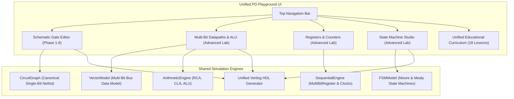

# PD Playground — Advanced RTL Lab: Future Integration Proposal

## 1. Context & Objective
The **Advanced RTL Lab** was developed autonomously and in complete isolation within worktree `rtl-playground-advanced` on branch `feat/advanced-rtl-lab`, based upon Git commit `f9c6d7b83a42ff62438e4013417cd18a38f59761`.

Concurrently, other contributor agents are working on:
1. **Phase 6**: Interactive RTL fundamentals, register enable, synchronous reset, and learning features on `phase-6-interactive-rtl`.
2. **Stress Testing**: Long-duration randomized stress testing harness on `test/stress-testing-harness`.
3. **HDL Verification**: Independent HDL verification closure on `hdl-verification-closure`.

This proposal outlines a clean, non-destructive path to integrate the Advanced RTL Lab into the main PD Playground platform once Phase 6 and peer branches are stabilized and merged.

---

## 2. File Organization & Conflict Analysis

### Conflicting Files
**Zero conflicts exist** with the current code, because all Advanced RTL Lab functionality was intentionally designed inside self-contained directories:
- `advanced-lab/` (Application entry point, UI visualizers, engine, curriculum, styles)
- `tests/advanced/` (Standalone test suites, property-based tests, CDP browser tests)
- `docs/advanced/` (Architectural decisions, progress tracking, verification reports)

The baseline files (`src/`, `index.html`, `tests/tests.js`, `docs/`) were **not modified**.

### Merge Strategy
When the project lead decides to integrate:
1. Merge `feat/advanced-rtl-lab` into `master` via a standard git fast-forward or non-fast-forward merge (`git merge --no-ff feat/advanced-rtl-lab`).
2. Add a navigation button / link in the main `index.html` header:
   ```html
   <a href="advanced-lab/index.html" class="nav-link-advanced">Advanced RTL Lab →</a>
   ```
3. Or integrate the Advanced Lab as a top-level tab inside the main unified PD Playground navigation bar:
   - "Gate-Level Schematic" (Original Phase 1-5 editor)
   - "Multi-Bit Datapaths & ALU" (`advanced-lab/ui/datapath_visualizer.js`)
   - "Registers & Counters" (`advanced-lab/ui/register_visualizer.js`)
   - "Finite State Machines" (`advanced-lab/ui/fsm_editor.js`)
   - "Curriculum Lessons" (Unifying `lessons.js` and `advanced_lessons.js`)

---

## 3. Architectural Unification Blueprint



### Shared Components to Reconcile
1. **Verilog HDL Generator**:
   - Original `src/engine/verilog_generator.js` handles gate-level netlists with structural instances and 1-bit `always @(posedge clk)` blocks.
   - `advanced-lab/engine/advanced_verilog.js` handles behavioral multi-bit arithmetic (`+`, `-`), multiplexers (`?:`), vector registers, and 2-process FSMs.
   - *Recommendation*: Merge both into a unified `VerilogGenerator` namespace where structural gate models and behavioral vector/FSM models share the same header and module naming conventions.

2. **Waveform Viewer**:
   - `src/ui/waveform_viewer.js` renders single-bit traces.
   - `advanced-lab/ui/advanced_waveforms.js` renders multi-bit hexagonal bus envelopes (`< HEX >`) and state string buses.
   - *Recommendation*: Adopt `advanced_waveforms.js` as the universal waveform engine across PD Playground, as it seamlessly supports both single-bit digital traces and multi-bit vector buses.

3. **Curriculum Unification**:
   - Base playground has 8 single-bit gate lessons (`src/modules/lessons.js`).
   - Advanced Lab has 10 multi-bit, datapath, and FSM lessons (`advanced-lab/lessons/advanced_lessons.js`).
   - *Recommendation*: Unify into an 18-lesson comprehensive digital VLSI course, organized into 4 progressive tiers:
     - Tier 1: Combinational Logic Fundamentals (Lessons 1-5)
     - Tier 2: Arithmetic Datapaths & Carry Chains (Lessons 6-9)
     - Tier 3: Sequential Registers, Counters & Pipelines (Lessons 10-14)
     - Tier 4: Finite State Machines & Controllers (Lessons 15-18)

---

## 4. Verification Checkpoint Before Integration
Before merging into `master`:
1. Run `node tests/advanced/run_all_tests.js` (Must pass all 7 suites).
2. Run `node tests/browser_smoke_test.js` (Verify Phase 5 baseline unaffected).
3. Run `node tests/advanced/browser_advanced_test.js` (Verify Advanced Lab browser audit).
4. Verify zero Git uncommitted changes or untracked temporary files.
